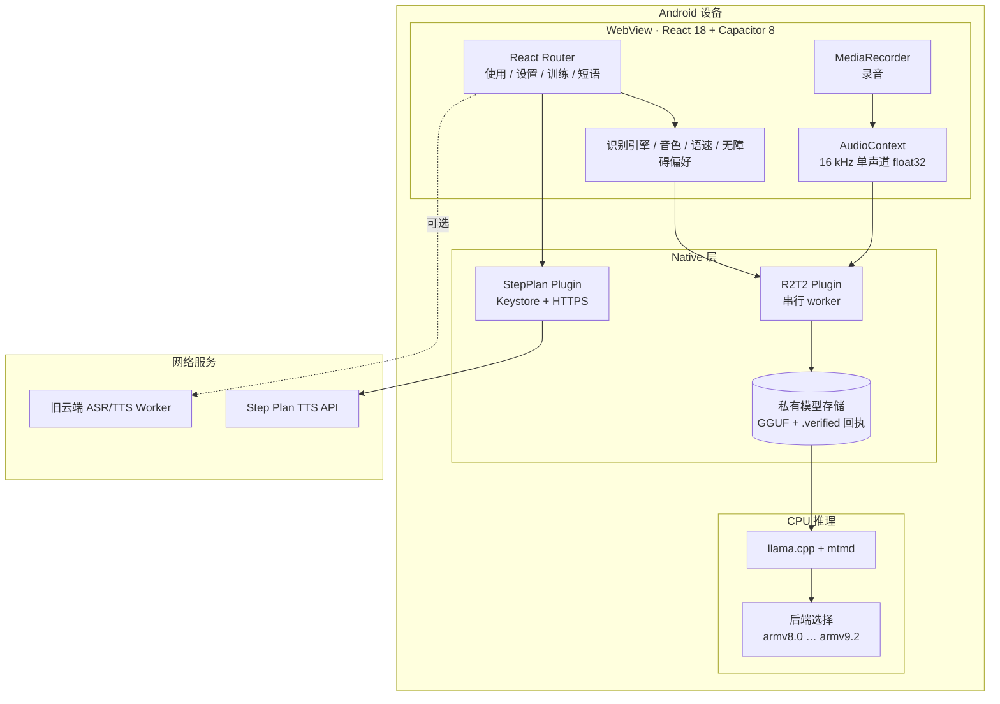
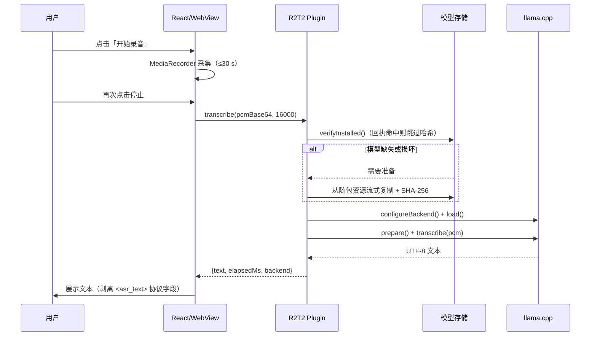
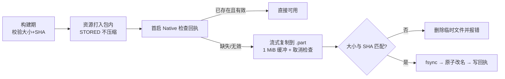
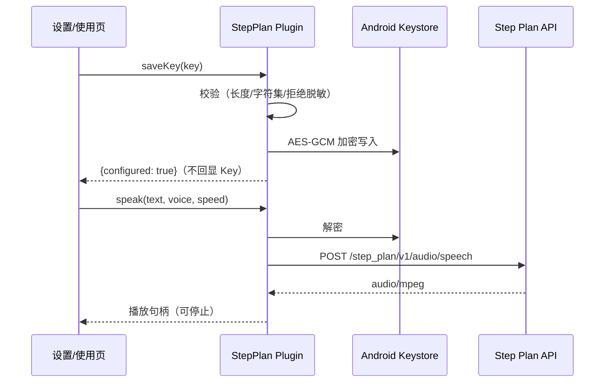

# 共鸣（Project Resonance）技术报告

> 版本：1.1 · 日期：2026-10-17 · 范围：Android 端侧语音识别 + 语音朗读接入
> 本报告只记录**已实测**的数据；未验证项在「限制与风险」中明确列出。

---

## 1. 摘要

共鸣是面向构音障碍者的语音训练与辅助沟通应用。本轮交付把原先需要联网下载模型的 Android 版，升级为**安装即用的端侧推理版本**：两个官方 GGUF 权重随应用分发，首次启动在本地流式展开并做大小/SHA-256 校验，之后完全离线识别。

同时评估了把 decoder 迁到 Hexagon NPU 的可行性。结论是**正确性可通过、性能不可用**（整句 287.4 s，session 创建占 83.8%），因此正式版本继续使用 CPU，NPU 仅作为技术评估归档。

| 项目 | 结果 |
|---|---|
| 端侧识别（官方 6.74 s 样音） | 3.3–3.9 s，文本完全正确 |
| 安装包 | 1,466,428,783 B（含权重），首次启动准备 6.4 s，**全程离线** |
| 单元测试 | 前端 104 项 / 15 文件；Android JVM 14 项 |
| 构建校验 | lint、签名、zipalign、13 个 ARM64 ELF 16 KB 对齐 |
| NPU 完整链路 | 文本正确但 287.4 s，**不接入** |

---

## 2. 系统架构

### 2.1 部署视图



### 2.2 识别时序



### 2.3 关键设计决策

| 决策 | 选择 | 理由 |
|---|---|---|
| 推理位置 | 设备 CPU | 离线、隐私、无需服务端成本；实测满足实时性 |
| 权重分发 | 随应用打包（ZIP STORED） | “安装即用”，避免首启联网下载失败 |
| 校验时机 | 构建期 + 首启期双重 SHA-256 | 防止资源被替换或截断 |
| 后端选择 | 运行时能力评分 | 一套包兼容 ARMv8.0–v9.2，不抬高全局指令要求 |
| 线程模型 | 单线程串行 worker | 避免模型加载/推理与取消竞争 |
| 朗读 | 独立 Step Plan 通道 | 与识别解耦；Key 走 Keystore，不回传 JS |
| NPU | 不接入 | 正确但慢 80×，见 §6 |

---

## 3. 端侧模型与预处理

| 项 | 值 |
|---|---|
| 解码器 | `Confucius4-R2T2-Q4_K_M.gguf`，1,107,404,736 B，`fa3cb46c…f6466` |
| 音频投影 | `mmproj-Confucius4-R2T2-Q8_0.gguf`，348,336,544 B，`8dc2c67e…8cb65` |
| 结构 | Qwen3-VL 架构，28 层，hidden 2048，16 Q / 8 KV heads，FFN 6144，词表 151,936 |
| 量化 | Q4_K_M（约 4.5 bit/权重）+ Q8_0 投影，未重新量化 |
| 运行时 | llama.cpp @ `ad6c668…e38948` + mtmd |
| 采样 | 贪心（temperature≈0），遇到 EOG 停止 |

**音频链路**：`MediaRecorder(WebM/Opus)` → `AudioContext.decodeAudioData` → 多声道混单 → `OfflineAudioContext` 重采样 16 kHz → float32 LE → Base64 → JNI。

**输出清洗**：模型输出含 `<|im_end|>`、`language Chinese<asr_text>` 等协议标记，前端只保留 `<asr_text>` 之后的正文。

---

## 4. 安装包与首次启动



- 包体：`resonance-offline-cpu-with-models.apk`，`1,466,428,783 B`，SHA-256 `0486cd47…af4ca3`
- APK 内两个 `.gguf` 均为 `compress_type=0`（STORED），与官方哈希逐字节一致
- 真机安装 72.5 s；首启离线准备 **6.4 s**，两文件大小与回执全部正确
- 已有有效模型直接复用，不重复复制；用户偏好与 Keystore 数据保留

---

## 5. 性能评测

### 5.1 识别延迟（官方 6.74 s 样音）

| 配置 | 延迟 | 说明 |
|---|---:|---|
| 正式版 CPU（优化后端） | **3.26 / 3.66 / 3.79 s** | `CPU android_armv8.6_1`，三轮均正确 |
| 正式版 CPU（baseline） | 8.66 / 9.50 / 9.74 s | `android_armv8.0_1`，兼容模式 |
| 隔离版 CPU 参考 | 3.61 / 3.92 / 3.67 s | 同一 fixture，独立进程 |
| HTP encoder + CPU decoder | 2.50 / 2.51 / 2.55 s | **不含** encoder 计算，非端到端 |
| 完整 HTP（encoder+decoder） | 287.43 s | 见 §6 |

RTF（实时率）约 **0.50–0.58**，即 1 秒语音约 0.5 秒完成识别。

### 5.2 资源

| 项 | 值 |
|---|---|
| 模型常驻内存 | 约 1.5 GB 量级（Q4_K_M + Q8_0 投影） |
| 首启磁盘占用 | 包体 + 私有模型 ≈ 2.9 GB |
| 建议预留 | ≥5 GB（安装解包 + 模型展开） |
| 设备基线 | Snapdragon 8 Gen 1 / Android 15 / 8 GB RAM |

---

## 6. NPU 评估（仅报告，不进产品）

### 6.1 做了什么

在隔离包中把完整模型导出为 HTP 图：27 个 encoder 阶段 + 28 个 decoder block + final norm + 19 个 head 分片，`htp_arch=69`、`session.disable_cpu_ep_fallback=1`、ORT QNN 1.20.0 / QNN 2.27.0。

### 6.2 正确性：通过

- 修复 RMSNorm 的 FP16 溢出（等价缩放 `s=max(1,max|x|)`）后，首 token 由错误的 `198` 恢复为 `101056`
- 28 层设备输出对齐主机参考：末层 cosine `0.999937`，最终 logits cosine `0.9999944`，host/device argmax 一致
- 完整 encoder→decoder 精确输出「之前有顾客自己带酒水，也没加收钱或者不让喝。」
- 75 个图文件（8.16 GB）设备哈希与 Manifest 全一致

### 6.3 性能：不可用

| 阶段 | 耗时 | 占比 |
|---|---:|---:|
| 整句 decoder 墙钟 | 287,431 ms | 100% |
| ├ session 创建（816 次） | 240,925 ms | **83.8%** |
| ├ session.run 实算 | 5,867 ms | 2.0% |
| └ 拷贝/Java/释放/报告 | 40,639 ms | 14.1% |
| encoder 缓存图链路 | 8,040 ms | — |
| encoder 冷编译链路 | 838,198 ms | — |

**根因**：无 KV cache 的全上下文重算（计算量约 100×）+ 每层每 token 重开 session + 48 个图边界往返 + FP16 权重带来的 3× 读写放大。

**决策**：不接入 NPU。若继续，需要 KV cache、持久 session、图融合与量化内存布局，并重新通过同一 fixture 的正确性与端到端性能门槛。

---

## 7. 语音朗读（Step Plan）



- 固定端点 `https://api.stepfun.com/step_plan/v1/audio/speech`，模型 `stepaudio-2.5-tts`
- 文本 ≤1000 字符，语速 0.5–2.0，`response_format=mp3`，不自动重试
- Key 仅存在 Android Keystore，JS 只读取 `{configured}`；网页端仅会话内存
- 停止 / 切后台 / 销毁 / 服务切换 / Key 更新都会取消请求并丢弃迟到响应，总时限 75 s
- 音色与旧云端服务分别保存，默认 `qinqienvsheng` / `alloy`

> 状态：**真实音频尚未验收**——需要用户在应用内填写自己的完整 Key。其余行为（保存、替换、移除、重启持久化、脱敏拒绝、独立音色）已在真机验证。

---

## 8. 无障碍与移动端 UI

- 底部导航触控目标 ≥48 dp；实测 384×823 下四栏各 89×60 px
- 键盘弹出后视口 384×465，自动滚动后控件与导航间距 23.99 px，无重叠
- 覆盖 320 / 360 / 412 px 与最大字号；无横向溢出
- 暖白 + 橙色主题，支持深色与高对比模式
- 训练与短语页支持分类、导入导出、100 条常用短语

---

## 9. 安全与隐私

| 面 | 措施 |
|---|---|
| 录音 | 仅前台录制，单次 ≤30 s；音频不经网络（本地模式） |
| 模型 | 应用私有目录；构建期与首启期双重 SHA-256 |
| API Key | Keystore AES-GCM；JS 不可读；日志不打印 |
| 网络 | 仅 HTTPS；原生白名单路径；旧 Worker 走 native transport |
| 依赖 | 审计仍有 18 项发现（10 moderate / 6 high / 2 critical），未做零漏洞声明 |

---

## 10. 验证矩阵

| 类别 | 项 | 结果 |
|---|---|---|
| 前端 | 15 文件 / 104 测试 | 通过 |
| 前端 | TypeScript / ESLint / Vite 构建 | 通过（ESLint 0 error，7 既有 warning） |
| Android | JVM 14 项（模型存储 8、策略 5、示例 1） | 通过 |
| Android | `assembleDebug` / `lintDebug` | 通过 |
| 包体 | 签名、zipalign、13 ELF 16 KB 对齐 | 通过 |
| 包体 | 两个 GGUF STORED 且哈希一致 | 通过 |
| 真机 | 离线首启准备模型 | 6.4 s 通过 |
| 真机 | 官方样音识别 | 文本正确，3.3–3.9 s |
| 真机 | 取消 / 后台 / 崩溃恢复 | 通过 |
| 真机 | Step Plan 密钥生命周期 | 通过（真实音频待 Key） |

---

## 11. 限制与风险

1. **真实朗读未验收**：无有效完整 Key，未发起鉴权合成。
2. **准确率未量化**：只验证单一官方 fixture；自然语音与构音障碍数据集未测。
3. **机型覆盖有限**：性能数据仅来自 Snapdragon 8 Gen 1；8 Gen 3 等仅理论可用。
4. **包体较大**：1.37 GiB，安装与首启需要约 5 GB 空间。
5. **依赖审计**：18 项发现未清零。
6. **NPU 评估不完整**：仅一条 fixture、无流式、无功耗与热稳定性。
7. **独立审查缺失**：review provider 不可用，本报告为手工审查，不等于独立批准。

---

## 12. 复现

```powershell
# 前端
cd web-app/frontend
npm run typecheck && npm run test && npm run build
npx cap sync android

# Android 构建（含模型校验与打包）
cd android
./gradlew :app:prepareBundledModels :app:testDebugUnitTest :app:lintDebug :app:assembleDebug

# 产物
# web-app/frontend/android/app/build/outputs/apk/debug/app-debug.apk

# 产品影片
python deliverables/evidence/demo/capture-stills.py
python deliverables/evidence/demo/compose-mobile-journey.py
```

---

## 13. 附件索引

| 内容 | 路径 |
|---|---|
| 单包交付说明 | `deliverables/README.md` |
| 安装包 | `deliverables/resonance-offline-cpu-with-models.apk` |
| 影片与素材 | `deliverables/evidence/demo/` |
| NPU 性能证据 | `deliverables/evidence/npu-v69/full-asr-performance.json` |
| NPU 设备收尾 | `deliverables/evidence/npu-v69/full-asr-final-environment.json` |
| 手机 UI 证据 | `deliverables/evidence/mobile-ui/` |
| 架构与方案 | `web-app/docs/specs/resonance-product-demo-architecture.md` |
| 连续性记录 | `web-app/.claude/CONTINUITY.md` |
