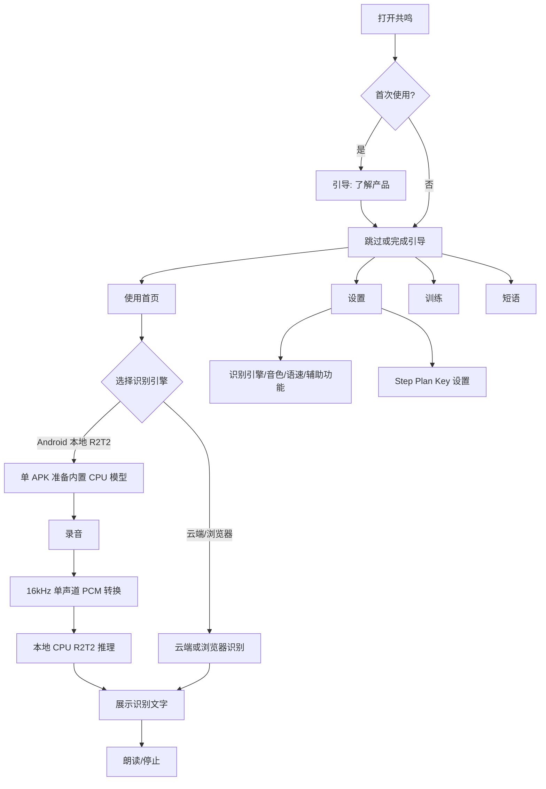
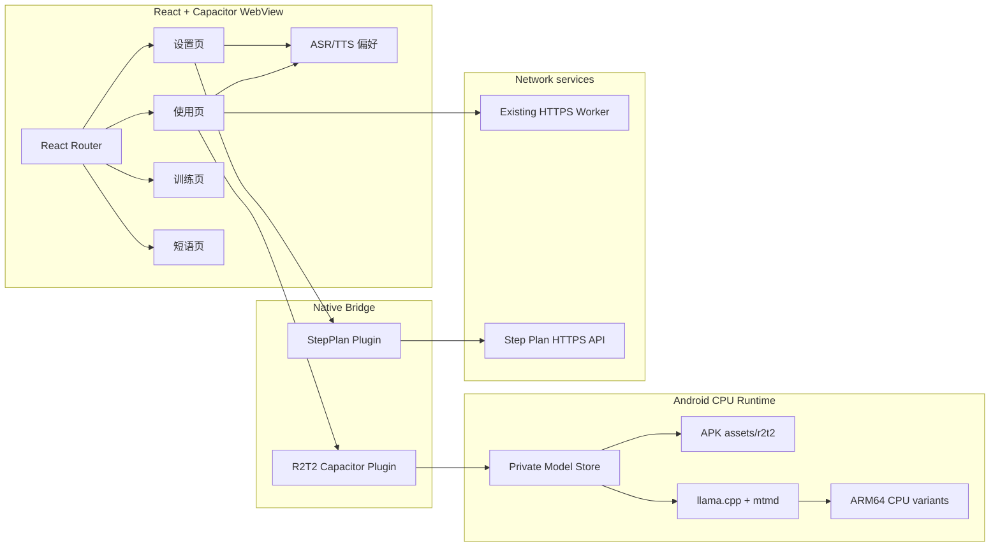

# Resonance 产品 Demo 与技术架构方案

## 目标

本文记录共鸣（Project Resonance）的产品 user journey、Demo 链接与技术架构。本文是产品与技术评估文档；NPU 实验只作为隔离评估结论，不进入正式 APK。

## Demo 入口

- 产品影片：`deliverables/evidence/demo/resonance-mobile-journey.mp4`（1080×1920，34 秒，真机页面）
- 影片索引与结构：`deliverables/evidence/demo/README.md`
- 网页 Demo：`http://127.0.0.1:8080/`（在 `web-app/frontend` 执行 `npm run dev -- --host 127.0.0.1`）

影片按 5 幕展示真实安装版的“使用 / 设置 / 端侧推理 / 训练 / 短语”，并对每页做导航态与渲染稳定性校验后再取帧。网页 Demo 与影片都不代替 Android 真机推理验收。
## User Journey

## 系统架构

## 端侧模型随应用分发

1. 构建期只读取两个指定官方 GGUF 文件。
2. 构建前验证大小与 SHA-256；任一不匹配则构建失败。
3. 模型随应用资源分发，GGUF 以 ZIP STORED 保存，避免首次启动额外压缩解码。
4. Native plugin 启动后检查私有目录中的模型与 `.verified` receipt。
5. 缺失或无效时，把随包资源流式复制到 `.bundled.part`，使用 1 MiB 缓冲、取消检查、大小检查和 SHA-256。
6. 关闭并 `fsync` 后再提升为正式模型文件，并写入 receipt；失败或取消不算安装完成。
7. 已有有效私有模型直接复用，不重复复制；用户偏好、Step Plan Keystore 与 CPU backend preference 保留。

模型：

| 文件 | 大小 | SHA-256 |
|---|---:|---|
| `Confucius4-R2T2-Q4_K_M.gguf` | 1,107,404,736 | `fa3cb46c8c3a66a58812b9098ba6e96a0266d4e8c9b3cf5ba34432fd2f9f6466` |
| `mmproj-Confucius4-R2T2-Q8_0.gguf` | 348,336,544 | `8dc2c67e6a0484114928142d098db7ad94ae9f34c78948ef9d37a9678418cb65` |

## CPU 运行时策略

正式 APK 只包含 ARM64 CPU 变体，启动时根据设备能力评分选择最优变体；仍保留 ARMv8.0 baseline 兼容模式。8 Gen 1 已实测选择 `CPU android_armv8.6_1`；8 Gen 3 理论上可使用更高 ARMv9 变体，但需要该设备实测确认。

当前正式 APK 不包含 QNN、HTP、NPU 图或 NPU runtime。完整 HTP v69 实验保留在 `.tools/r2t2-npu/`，没有写入生产应用。

## NPU 评估结论（仅技术报告）

隔离包在 `htp_arch=69`、`session.disable_cpu_ep_fallback=1` 下完成了官方 fixture 的完整 HTP encoder→decoder 正确性验证；但当前图切分方案采用无 KV cache 的因果重算，并为每个阶段/每个 token 重建 session。17 token 整句耗时约 `287.431 s`，其中 session 创建约 `240.925 s`，明显慢于 CPU 的约 `3.3–3.9 s`。

因此：

- 不将 NPU 代码或图写入正式 APK；
- 不把单层 HTP、encoder 或 hybrid 正确性宣传为产品 NPU；
- 如果未来继续评估，优先设计持久 session、KV cache、图融合和量化内存布局；
- 新方案必须用同一 fixture 同时通过正确性、无 fallback 和端到端实时性门槛。

证据：`deliverables/evidence/npu-v69/full-asr-performance.json`。

## Step Plan 边界

Step Plan 朗读使用固定 HTTPS API 和 Android Keystore AES-GCM 私有 Key 存储。Key 不打进 APK、不出现在 Demo、不写入技术报告。真实音频验收仍需要用户在应用内输入自己的完整 Key，并要求网络连接；“端侧模型”只保证识别离线，不保证离线 TTS。

## 验证与交付

- 前端：15 个测试文件、104 项测试通过；TypeScript 与 Vite 构建通过。
- Android：14 项 JVM 测试通过；assembleDebug、lintDebug 通过。
- 安装包：`deliverables/resonance-offline-cpu-with-models.apk`。
- APK SHA-256：`0486cd47e2f326b83b0a7508debd7afe91114a4a8296c8f064b1298ca1af4ca3`。
- 包内两个 GGUF 均为 STORED；签名、zipalign 和 13 个 ARM64 ELF 16KB LOAD 对齐通过。
- 真机离线首次启动准备模型约 6.4 秒；准备期间保持屏幕常亮，之后恢复设备原始设置。

独立审查 provider 不可用，本文不声明独立批准；依赖审计发现仍按既有交付文档记录。

## 产品影片

- 成片：`deliverables/evidence/demo/resonance-mobile-journey.mp4`（1080×1920 竖屏，30 fps，34 秒）
- 结构：片头 + 5 幕（使用 / 设置 / 端侧推理 / 训练 / 短语）+ 片尾
- 制作：`capture-stills.py` 逐页校验“导航选中态 + 正文对比度 + 连续两帧一致”后取静帧；`compose-mobile-journey.py` 做推拉、卡片化、字幕、进度条与交叉淡化
- 对外口径统一使用“端侧大模型推理”，不出现机型、芯片型号或分发实现细节
- 校验：无黑帧段，SHA-256 记录在 `deliverables/evidence/demo/README.md`
